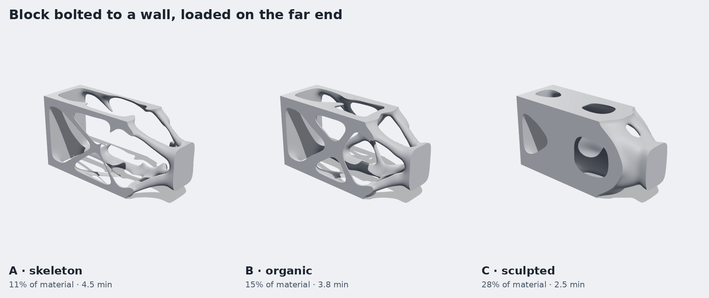
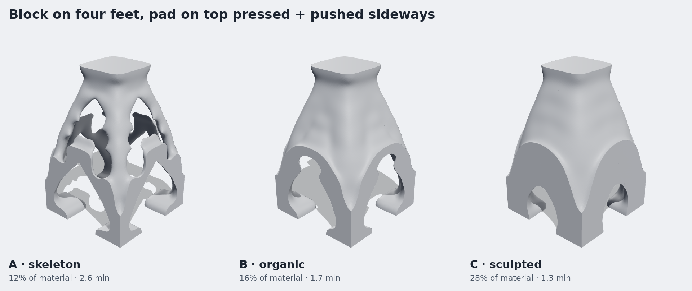
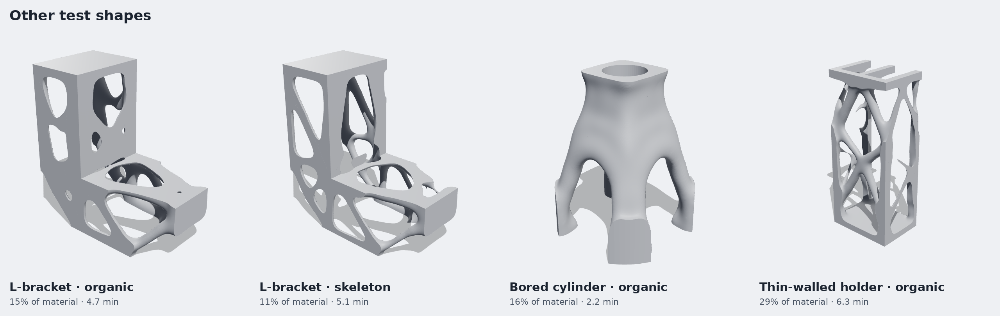
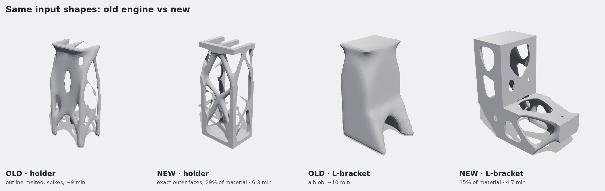
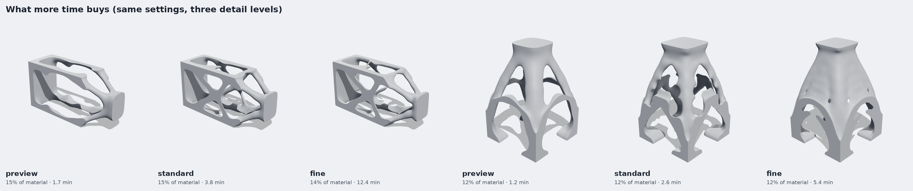

# Topology Optimization Studio v2

STL in, organic topology-optimized STL out. This replaces the engine in
`Test 1 FAIL mac topostudio/`, which produced melted-looking parts and took
20-80 minutes without the result getting any better.




## Run it

```bash
bash setup.sh
```

```bash
bash run.sh
```

Open <http://localhost:8501>. Upload an STL (or pick a sample), pick a look,
pick how the part is held and loaded, press **Quick preview**, then **Final**.

Without the UI:

```bash
.venv/bin/python optimize.py my_part.stl out.stl --style organic --load stand
```

```bash
.venv/bin/python optimize.py --list
```

## The looks

| Style | Material kept | What you get |
|---|---|---|
| `skeleton` | 12% | Thin branching bones, lots of open space |
| `organic` | 16% | Smooth limbs that fork and merge, the classic generative-design look |
| `sculpted` | 28% | Thick flowing vaults and arches, few openings |

The two numbers behind a style are the material budget and the minimum member
size (as a fraction of the part's longest side). **Little material with a large
member size gives struts.** Little material with a small member size gives a
thin skin full of small holes, which is the "weird" look from the first studio.
Both are sliders under *Fine-tune*.

On a thin-walled part (a channel, a bracket made of plates) members cannot be
thicker than the walls, so the member size is capped automatically and the
budget is raised: you get the original walls with organic windows cut in them.



## What was wrong before, and what changed



**1. The optimizer never converged, so extra time bought nothing.** Every saved
run of the old engine (`runs/*/record.json`) spent its last 20 iterations with
the design changing by the maximum allowed step each time: it was flip-flopping
between two states. That is a known instability of the textbook update rule
once Heaviside projection is switched on. `f1_hero` ran 81 minutes that way
without ever settling. The new update
(softer exponent plus averaging sensitivities across iterations) settles, and
the run stops on its own when the design stops moving.

**2. The surface was built from the wrong field.** The old exporter
marching-cubed the 0/1 voxel field at solver resolution, with everything
outside the part treated as empty. That rounded off the part's own faces,
showed voxel steps on every strut and turned thin grey members into spikes.
Now the smooth pre-projection density is continued through the part's faces,
upsampled 4-5x, smoothed, and then boolean-cut with the original STL. Outer
faces, edges and holes of your part come back exactly as modelled (the
L-bracket test is 80.000 x 40.000 x 80.000 mm in and out) and only the carved
interior is organic. Every test output is watertight.

**3. Loads on whole faces make plates, not struts.** Pressing on an entire top
face forces a solid skin under it. The load setups here use pads and feet with
a thin solid pad kept under each, so the material in between is free to branch.

**4. It was slow for no reason.** Half-resolution first pass, a lighter
stiffness-matrix assembly, a better-tuned multigrid preconditioner and a
looser (but sufficient: designs are identical) linear-solve tolerance.

## How long it takes



Measured on a 4-core cloud VM with four jobs running at once; one job uses one
core, so an Apple-Silicon Mac should be noticeably faster.

| Detail | Solver voxels | Time here | Use it for |
|---|---|---|---|
| preview | ~14,000 | 1-1.5 min | Checking the load setup and the general layout |
| standard | ~40,000 | 1.5-6 min | The result. Already smooth, because smoothness comes from the surface step, not the solver grid |
| fine | ~110,000 | 5-12 min | `skeleton`, where thin members need the extra voxels to stay connected |

Past *standard* the shape does not get better, only slightly different.
Preview, standard and fine are the same design problem at three resolutions,
so they land on related but not identical layouts.

## Load setups

`stand` (four feet, pad on top), `pillar`, `pillar_feet`, `cantilever`,
`shelf`, `hanger`, `bridge`. Each is "held here, pushed there" on the part's
bounding-box faces, with a sideways push added so the optimizer has a reason to
brace. `python optimize.py --list` describes them. Z is up; use `--up y` or the
dropdown if your STL stands along another axis.

## Layout

```
app.py                 the UI
optimize.py            command line
make_test_shapes.py    writes samples/*.stl
engines/voxel.py       STL -> voxels (exact size, fast on million-triangle meshes)
engines/topopt.py      the SIMP solver
engines/surface.py     density -> smooth STL, cut against the original part
engines/pipeline.py    styles, load setups, the one-call run()
tests/                 python -m pytest tests -q
docs/                  the images above
```

## Known limits

* Stiffness is approximate; this is for good-looking printable parts, not
  certified ones.
* `skeleton` at *standard* detail can drop a thin member or two; use *fine*.
* Shapes can contain enclosed hollows (fine for FDM with no supports inside,
  a problem for resin).
* Loads and supports are chosen from presets on bounding-box faces. Picking
  them by clicking on the model is not built yet.
